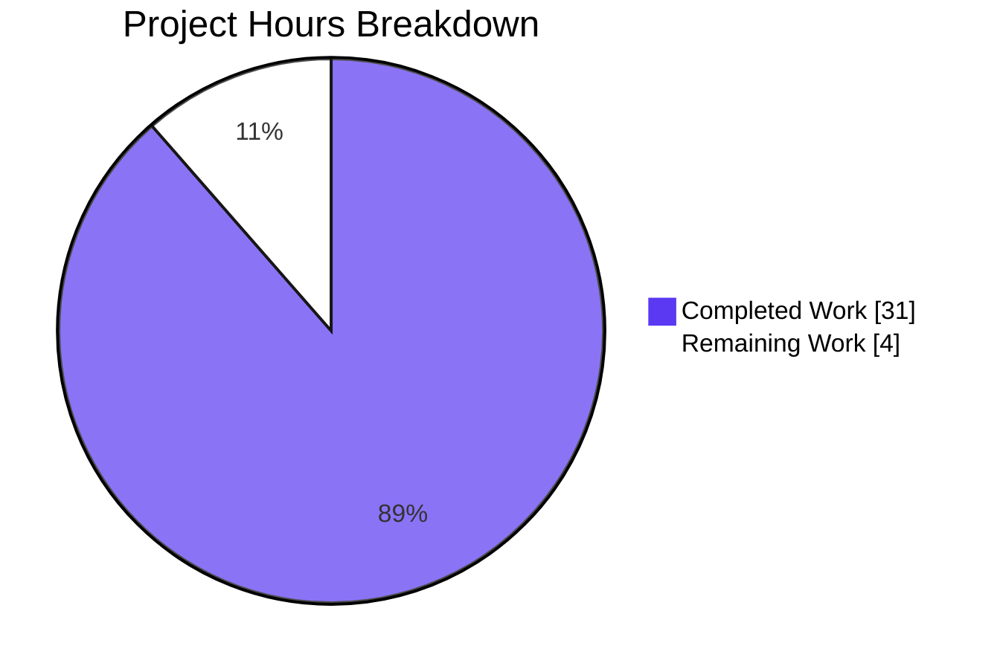

# 1. Executive Summary

## 1.1 Project Overview

Two files at the repository root are the whole deliverable. `print_welcome.sh` is a one-line POSIX shell program whose entire source is `echo Welcome to Blitzy`; it writes exactly 18 bytes — the 17-character literal plus one newline — to standard output and exits 0, with no formatting. `hello_world.txt` holds that same literal on exactly 42900 lines, 772200 bytes, committed as literal content no script produces. Its consumers are the requester and any automated verifier counting lines or comparing bytes. The footprint is deliberately minimal: no dependency, build step, configuration, service, test or in-tree documentation.

## 1.2 Completion Status

| Metric | Hours |
|--------|-------|
| Total Hours | 35.0 |
| Completed Hours (AI + Manual) | 31.0 |
| Remaining Hours | 4.0 |

Completion is calculated from the plan's own scope: 31.0 / (31.0 + 4.0) = **88.6% complete**.



## 1.3 Key Accomplishments

- One-line program verified: exactly 18 bytes on stdout, exit 0, identical under `sh`, `bash`, `/bin/sh` and `dash`.
- Data artifact verified: 42900 lines, 772200 bytes, sha256 `57ea77eb…c196d9c`, final line LF-terminated.
- No generator in the tree or its pipeline: the file's bytes are committed literal content.
- Minimal footprint: two files, zero manifests, zero packages, zero extra tools.
- Environment independence: identical output under an empty environment, four locales and an unusable `PATH`.
- Non-interference: the program opens no file; the data file's identity is unchanged by every run.
- Checkout stability: no line-ending or attribute configuration exists, and each file matches its committed blob.
- Every acceptance value reproduces exactly, including the 11-value whole-package gate.

## 1.4 Critical Unresolved Issues

Five open items, none blocking release: **0 of the 5 requested deliverables is unfinished**. Each item below is a caveat recorded for the owner.

| Issue | Impact | Owner | ETA |
|-------|--------|-------|-----|
| `bash print_welcome.sh` with a caller-set `BASH_ENV` prints the caller's line before the contract bytes | An extra line for one caller configuration only; the documented `sh` run is unaffected | Integration owner | With the invocation review (0.5 h) |
| The file carries no executable bit, so `./print_welcome.sh` exits 126 | Consumers expecting direct execution must name an interpreter | Integration owner | With the invocation review (1.0 h) |
| The 42900-line / 772200-byte contract is stated nowhere inside the tree | A reader of the tree alone cannot recover the contract | Project owner | With the drift guard (1.0 h) |
| No coding standard is on record for the project | Future changes have no documented standard to bind them | Project owner | With the standard record (0.5 h) |
| Destination failure behaviour is undefined (closed stdout, full sink, early-closing reader) | A consumer that breaks the destination must not assume exit 0 | Integration owner | With the failure-path note (0.5 h) |

## 1.5 Access Issues

No access issues identified. Neither artifact depends on a service, credential, API key or configuration value.

## 1.6 Recommended Next Steps

1. [High] Confirm the invocation contract: run the program as `sh print_welcome.sh`, decide how direct execution is handled, and keep `BASH_ENV` away from any `bash` invocation.
2. [High] Reproduce the acceptance set on the target host from a fresh clone and confirm the file modes a checkout yields there.
3. [Medium] Protect both byte contracts: keep line-ending, formatter and hook tooling out of the tree, and carry the contract with the consumer.
4. [Medium] Record the project's rule set as a standing fact.
5. [Low] Document destination failure behaviour for consumers.

# 2. Project Hours Breakdown

## 2.1 Completed Work Detail

| Component | Hours | Description |
|-----------|-------|-------------|
| `print_welcome.sh` — one-line program and its output contract | 3.0 | The complete source line, the 18-byte stdout contract, exit status, interpreter invocation and the POSIX portability of the single utility used. |
| `hello_world.txt` — 42900 literal lines authored as committed content | 10.5 | The full 772200 bytes written as literal content by bounded append operations with a line-count check after each, then never rewritten: exact literal, exact case and spacing, LF termination including the final line. |
| Byte-contract verification and the acceptance sets | 4.0 | The eight data acceptance commands and the five program acceptance commands executed against the working tree, with their outputs recorded as the evidence of completion. |
| Two-file tree, scaffold removal and the absence inventory | 2.5 | Exactly the two mapped files at the root, the removal of the pre-existing placeholder document, and the enumeration of the absent manifests, lockfiles, configuration, pipelines, containers, tests and generator scripts. |
| Non-interaction, no-write control and determinism verification | 3.5 | Proof that the program opens no file and writes only to standard output, that the data file's identity is unchanged by every execution, and that the output is independent of environment, locale and working directory. |
| Runtime and adversarial exercise of the program | 5.0 | Four interpreters, argument and standard-input robustness, hostile working directories, environment variations, repeated and concurrent runs, and the destination and write-failure probes. |
| Repository hygiene: commits, blob identity and line-ending integrity | 1.5 | One commit per file with nothing pre-existing modified beyond the sanctioned deletion, worktree bytes byte-identical to the committed blobs, and no attribute or line-ending configuration able to rewrite either file. |
| Rule-set establishment and the quality-gate decision | 0.5 | Establishing that no user rule constrains the work or the tree, and recording the decision that the acceptance commands, not a committed test suite, are this project's quality gate. |
| Exact-count reconciliation and output-fidelity review | 0.5 | Reconciling the request's approximate figure to the exact 42900 in every count and confirming no other figure appears in either file. |
| **Total** | **31.0** | Matches Completed Hours in Section 1.2. |

## 2.2 Remaining Work Detail

| Category | Hours | Priority |
|----------|-------|----------|
| Host and fresh-checkout verification of both byte contracts: reproduce the acceptance set on the target machine and confirm the file modes and line-ending attributes a fresh clone yields there | 0.5 | High |
| Consumer invocation contract: confirm the program is run through `sh`/`dash`, decide how direct `./print_welcome.sh` execution is handled, and ensure no caller-set `BASH_ENV` reaches a `bash` invocation | 1.5 | High |
| Byte-contract drift guard: keep line-ending, formatter, hook and regeneration tooling away from both files, and carry the 42900-line / 772200-byte / digest contract with the consumer since the tree states nothing | 1.0 | Medium |
| Coding-standard record: no rule text is on record for this project, so record the empty rule set as the standing standard | 0.5 | Medium |
| Destination failure behaviour documented for consumers: closed stdout, a full sink and an early-closing reader | 0.5 | Low |
| **Total** | **4.0** | Matches Remaining Hours in Section 1.2 and "Remaining Work" in Section 7. |

# 3. Test Results

| Area / Category | Framework | Tests | Passed | Failed | Coverage | What This Proves |
|-----------------|-----------|-------|--------|--------|----------|------------------|
| Data artifact byte contract | POSIX shell acceptance set (`wc`, `grep`, `sort`, `od`, `sha256sum`) | 8 | 8 | 0 | Not applicable — a fixed-content artifact asserted by exact counts | Every one of the 42900 lines is the literal and nothing else, and the size, final terminator and digest are exact |
| Program output contract | `sh` | 5 | 5 | 0 | Not applicable | Standard output is the 18-byte literal plus one newline, with no decoration, and the process exits 0 |
| Interpreter portability | `sh`, `bash`, `/bin/sh`, `dash` | 4 | 4 | 0 | Not applicable | The same 18 bytes are emitted whichever POSIX shell runs the program |
| Source syntax | `sh -n`, `bash -n`, `dash -n` | 3 | 3 | 0 | Not applicable | The one-line source parses cleanly under all three shells |
| Whole-package acceptance gate | POSIX shell, 11 values in sequence | 11 | 11 | 0 | Not applicable | The delivered tree satisfies every gate value end to end, in order |
| Runtime behaviour and adversarial probes | Shell harness across four interpreters | 1231 | 1230 | 1 | Not applicable — no coverage tooling exists | Arguments, standard input, working directory, environment, locales, repetition, concurrency and destination variations never change the output; the one non-passing case is a `bash` invocation with a caller-set `BASH_ENV` |
| Data-artifact identity and inertness | Git object store and byte probes | 11 | 11 | 0 | Not applicable | The committed bytes equal the working file, and the whole-file byte census, block census, taper check and negative controls all hold |
| Minimal-footprint inventory and absence probes | Shell probes over the tree | 84 | 84 | 0 | Not applicable | Only the two mapped files exist: 39 file names, 13 directory names and the 17 named generator constructs are absent |

Across the eight categories 1357 checks were executed, 1356 passed, and one did not. The figures are executions rather than distinct cases — the contract is re-exercised after each change, so the categories overlap by design and their counts must not be added for a "distinct test" total.

**Not Covered**

- No committed test suite, test framework or coverage tooling exists by design, so nothing runs automatically when either file changes; the acceptance sets above are run by hand.
- The data file's content is asserted through counts and a digest rather than by reading 42900 lines back, which is what the contract itself prescribes but does mean no human or tool has read the whole file.
- Failure behaviour on a broken destination — closed standard output, a full filesystem, a reader that closes the pipe early — is asserted by no test, because the contract specifies exit 0 only for the documented invocation with standard output open.
- Direct `./print_welcome.sh` execution is not exercised by any acceptance check; the file is deliberately not executable.
- A `bash` invocation under a caller-set `BASH_ENV` is not asserted as a passing case.
- No linter is installed, so a linter-depth static analysis of the one-line source was not performed; the interpreter syntax checks are the whole static gate.
- No syscall-level tracing was possible on the verification host, so the "writes no file" control rests on identity readings taken around each run rather than on traced system calls.
- Nothing outside this repository that reads `hello_world.txt` is exercised anywhere here, so the contract is verified but no real consumer is.

# 4. Runtime Validation & UI Verification

Runtime validation was driven entirely through a POSIX shell on the verification host (macOS 26.6.1 arm64, `/bin/sh` = GNU bash 3.2.57 in POSIX mode, `/bin/dash` and `/bin/bash` 3.2.57 also present). Nothing was built, installed, started or seeded: the project has no build step, service, database, container, port or network reach.

- ✅ **Program start-up and documented invocation** — `sh print_welcome.sh` writes 18 bytes to standard output, leaves standard error empty and exits 0; `echo` resolves as the interpreter's own builtin, so a decoy `echo` placed first on `PATH` is never executed.
- ✅ **Interpreter variants** — `bash`, `/bin/sh` and `/bin/dash` each emit byte-identical output to the `sh` run.
- ✅ **Environment independence** — `env -i`, an empty `PATH` and `PATH=/nonexistent`, four locales including `tr_TR.UTF-8`, and variations of `IFS`, `CDPATH`, `POSIXLY_CORRECT`, `TZ`, `HOME`, `TMPDIR` and `COLUMNS` all give identical bytes; the supplied `Apple` and `Orange` values and the `api1` secret produce no change set, unset or empty.
- ✅ **Argument and standard-input robustness** — 21 argument shapes (option-like, metacharacter, injection-shaped, traversal, 10000-character, unicode and emoji) and five input shapes including a FIFO held open by a writer produce identical output and create nothing.
- ✅ **Working-directory independence** — running from `/`, from a read-only directory and from paths containing metacharacters, quotes, spaces or unicode all give identical output.
- ✅ **Repetition, concurrency and cost** — 100 sequential runs and 64 simultaneous runs yield one distinct output with no non-zero status; roughly 2.3 ms per invocation.
- ✅ **Non-interference** — no run creates, modifies or deletes a file anywhere; the data file's digest, size, line count, mode and mtime are unchanged after every batch, and a sentinel directory with `TMPDIR` and `HOME` repointed is left untouched.
- ✅ **Shared-literal seam** — the program's standard output is byte-identical to the first line of `hello_world.txt`.
- ⚠ **Interpreter start-up** — `bash print_welcome.sh` with a caller-set `BASH_ENV` prefixes the caller's own line (49 bytes instead of 18); `sh`, `/bin/sh`, `/bin/dash` and `sh` with `ENV` are unaffected, and the documented invocation is `sh`.
- ❌ **No failing flow** — no delivered flow fails.

**Never exercised at runtime.** The project exposes no page, endpoint, screen, port or desktop surface, so no browser or interactive validation exists or could exist. `hello_world.txt` is never opened, sourced or interpreted by anything in the repository — no file names it — so its behaviour as a consumer's input is untested, and nothing outside this repository was driven against either artifact. Direct `./print_welcome.sh` execution cannot occur because the file carries no executable bit, and no pipeline, container, service manager or scheduler runs either artifact, because no build, deployment, test-runner or CI definition exists. Destination failure paths were probed as observations only — a closed standard output, a full sink and an early-closing reader — and no requirement covers them.

# 5. Compliance & Quality Review

## 5.1 Compliance Matrix

| # | Deliverable / Benchmark | Status | Verified State |
|---|-------------------------|--------|----------------|
| 1 | Exact literal fidelity — data file (F2; plan §0.5.1) | ✅ PASS | 42900 lines, 42900 whole-line matches, 0 non-literal lines, 1 distinct line, `sha256` `57ea77eb…c196d9c`. |
| 2 | Exact output contract — program (F1; plan §0.5.2) | ✅ PASS | 18 bytes on standard output (`Welcome to Blitzy` + LF), no decoration, empty stderr, exit 0. |
| 3 | No-generator constraint (F3; plan §§0.5.1, 0.9.2) | ✅ PASS | Generator scan of the tree returns nothing; no build, Makefile, script target, template, formatter configuration or active pre-commit hook exists. |
| 4 | Minimal footprint (F4; plan §§0.5.2, 0.8.1) | ✅ PASS | One line / 23 bytes of source; two files; 0 manifests, 0 packages, 0 extra runtimes or tools. |
| 5 | Two-file tree and removal of the placeholder (plan §§0.8.1, 0.10.1) | ✅ PASS | Exactly `print_welcome.sh` and `hello_world.txt` at the root; `README.md` absent; change set is one deletion plus two additions with nothing modified. |
| 6 | Authoring integrity (plan §§0.5.1, 0.13.1) | ✅ PASS on outcome, geometry departed | File authored as literal content by bounded appends with a line-count check after each and never rewritten; the append size departed from the stated 20 × 2145 (§5.2, D1). |
| 7 | Acceptance evidence as the quality gate (plan §§0.5.1, 0.5.2, 0.13.2) | ✅ PASS | All eight data rows and all five program rows reproduce exactly, plus the 11-value whole-package gate in order. |
| 8 | Checkout stability of the byte contracts (plan §0.1.1 implicit) | ✅ PASS | `git ls-files --eol` = `i/lf w/lf attr/` for both files, no attributes set, `core.autocrlf`/`core.eol` unset, each file byte-identical to its committed blob. |
| 9 | Non-interaction and the no-write control (plan §§0.3.2, 0.5.1; F3) | ✅ PASS | The program opens no file and names none; one write of 18 bytes to file descriptor 1; data-file identity unchanged by every execution. |
| 10 | Determinism and environment independence (plan §0.1.1) | ✅ PASS | Identical bytes under an empty environment, four locales, empty/unusable `PATH`, varied `IFS`/`CDPATH`/`TZ`/`TMPDIR` and all working directories exercised. |
| 11 | Security posture (plan §§0.3.2, 0.3.3, 0.13.2) | ✅ PASS | No input surface, credential, secret, socket, subprocess, temporary file, filesystem write or dependency; the data file is inert ASCII with a 13-value byte alphabet and no execute bit. |
| 12 | Committed test suite, linter configuration, CI/CD and in-tree documentation (plan §0.9.2 exclusions) | ⚪ NOT APPLICABLE BY DESIGN | Each absence verified as a counted zero. The consequence: nothing runs automatically when either file changes, and the contract is stated nowhere inside the tree (§6, T2; §5.2, D5). |

## 5.2 AAP & Rule Divergences and Gaps

| # | What the AAP/Rule Required | What Was Delivered Instead | Why It Diverged | Impact | Remediation |
|---|----------------------------|----------------------------|------------------|--------|-------------|
| D1 | Authoring the data file as 20 sequential appends of exactly 2145 literal lines, counting lines after each (plan §0.5.1, §0.7.1-B5, §0.9.1) | More, smaller literal appends of roughly 800–975 lines each, with the same line-count check after every append | A single authoring operation could not reliably carry 2145 lines; the file's own instruction sanctioned smaller literal appends and the plan's correction clause allows a short or long chunk to be fixed by authoring or removing literal lines | None on the delivered contract — the bytes are exact and the 20 × 2145 boundary structure is intact; provenance only | None required |
| D2 | "No existing file is updated or deleted — the repository is empty, so there is nothing to modify" (plan §0.10.1, on the premise in §0.1.1) | `README.md`, the base commit's only tracked file, was deleted alongside the two new files | The premise did not match the repository: the base commit tracked a 57-byte, two-line placeholder. The two-file tree contract and the minimal-footprint exclusion of documentation decided the deletion | None on the deliverables; the only change to pre-existing content is that deletion | None — the placeholder cannot coexist with a two-file tree |
| D3 | Invocation as `sh print_welcome.sh`, equivalently `bash print_welcome.sh` (plan §0.8.2) | File left at mode 100644 with no shebang, so `./print_welcome.sh` exits 126 and an interpreter must always be named | A shebang would make the program two lines and break the one-line/23-byte budget the request fixes | Consumers expecting direct execution cannot run it that way | Document the invocation, or decide to amend the contract (1.0 h, §2.2) |
| D4 | A linter pass over the source, as the plan's quality standards anticipate (plan §0.13.2) | No linter run; `sh -n`, `bash -n` and `dash -n` used instead (all exit 0) | No linter is installed on the host and the minimal-footprint rule forbids adding tooling to the repository | Static analysis stops at interpreter syntax checking | Optional: install a shell linter outside the repository; nothing may enter the tree (no hours) |
| D5 | The contract stated for the consumer (plan §§0.5.1, 0.5.2) | Nothing in the repository states the 42900-line / 772200-byte / digest contract or the invocation | The plan excludes all documentation from the tree, so the contract exists only in the plan and in the acceptance commands | A reader of the tree alone cannot recover the contract, which makes accidental change harder to detect | Carry the contract with the consumer and run the acceptance set on change (1.0 h, §2.2) |
| D6 | The rule text read from the source that holds it (plan §0.11) | The empty rule set was established from the plan's own statement plus a search of the repository that found no rule artefact | No rule text could be read for this project: the source that would carry it was not reachable, and the tree contains no rule artefact of any kind | No rule text is on record, so no documented coding standard binds future changes | Record the empty rule set as a standing fact (0.5 h, §2.2) |
| D7 | Exit 0 and exactly 18 bytes for the documented invocation (plan §§0.5.2, 0.7.1-A) | The documented `sh` invocation is exactly 18 bytes and exits 0; `bash print_welcome.sh` with a caller-set `BASH_ENV` prints the caller's line first (49 bytes) | Interpreters source caller-specified start-up files before running any script; a 23-byte, shebang-less program has no way to guard against it | An extra line for that one caller configuration; `sh`, `/bin/sh`, `/bin/dash` and `sh` with `ENV` are unaffected | Caller-side: invoke through `sh`/`dash` or clear `BASH_ENV` (0.5 h within §2.2) |
| D8 | Exit status 0 (plan §0.5.2) | A broken destination behaves as the shell does: closed standard output exits 1, a full sink exits 153, an early-closing reader yields 141 | The plan deliberately omits error handling and fixes exit 0 only for the documented invocation with standard output open | A consumer that breaks the destination must not assume exit 0 | Document the behaviour for consumers (0.5 h, §2.2) |

**D1 — append geometry.** The plan fixed the file's authoring at 20 sequential appends of 2145 literal lines each. The delivered file was built from more, smaller literal appends of roughly 800–975 lines, each followed by a line-count check. One authoring operation could not reliably carry 2145 lines at a time, the file's own instruction permitted smaller literal appends, and the plan's correction clause allows a mis-sized chunk to be fixed by authoring or removing literal lines. The outcome is unaffected: `wc -l` reports 42900, the file is a clean multiple of 2145 with no thinning at the end, and the digest matches. Nothing needs doing; the reader should simply know the recorded provenance differs from the stated mechanism.

**D2 — empty-tree premise and the deleted placeholder.** The plan stated that the repository was empty and that no existing file would be updated or deleted. In fact the base commit tracked one file, `README.md`, 57 bytes over two lines: a repository-name heading and a "Created by Blitzy" note. That file was deleted in commit `de34d48` together with the addition of `print_welcome.sh`, so the tree is exactly the two mapped files. The deletion was settled against the disk because the two-file tree and the exclusion of documentation left no room for it. Nothing needs doing: keeping the placeholder would have made the tree three files and broken the two-file budget.

**D3 — no executable bit, no shebang.** The plan fixes the invocation as `sh print_welcome.sh` — equally `bash`, `/bin/sh` or `dash` — and the delivered file is committed at mode 100644 with no shebang, so `./print_welcome.sh` fails with exit 126. A shebang would have made the program two lines and broken the one-line, 23-byte budget the request insists on. The consequence is that every consumer must name an interpreter; a `chmod +x` copy of the same bytes runs identically. Decide whether the contract stays interpreter-based and is documented for consumers, or whether it is amended — the second option cannot be met inside the current budget.

**D4 — the linter pass.** The plan's quality standards anticipate a linter pass over the source. None was run because no linter is installed on the host (`shellcheck` is absent) and the minimal-footprint rule forbids adding tooling to a repository whose whole content is two files. The interpreter syntax checks `sh -n`, `bash -n` and `dash -n` were used instead and all exit 0, which is the entire static gate for a one-line program. If a deeper static opinion is wanted, install a shell linter outside the repository and run it against a copy; nothing may be added inside the tree, and no acceptance value depends on the tool.

**D5 — the contract is stated nowhere in the tree.** The plan excludes all documentation from the repository, so nothing in the tree records that `hello_world.txt` must hold exactly 42900 lines, that the digest is `57ea77eb…c196d9c`, or that the program is invoked as `sh print_welcome.sh`. A reader who opens the repository alone cannot recover any of it, which matters because both contracts are exact and easy to break silently. Carry the contract with the consumer — the pull request description, a runbook or the consumer's own documentation — and make the acceptance commands the review step for any change to either file.

**D6 — no rule text on record.** The plan states that no user rules were provided and that no coding standard, mandated file, protected component or approval gate governs this work, and it expects the rule text to be read from the source that holds it. No such text could be read for this project: that source was not reachable, and a search of the repository found no rule artefact of any kind. The empty rule set therefore rests on the plan's own statement. Record it as a standing fact, so later work inherits a stated baseline rather than an assumption.

**D7 — interpreter start-up can prefix the output.** The documented `sh` invocation emits exactly the 18 contract bytes and exits 0, as do `/bin/sh`, `/bin/dash` and `sh` with `ENV` set. When a caller invokes `bash print_welcome.sh` and has set `BASH_ENV` to a file of its own, bash sources that file first and its output precedes the literal — 49 bytes in the case exercised. This is interpreter start-up behaviour, not output from the program, and a 23-byte, shebang-less script has no way to guard against it within the budget. Keep `BASH_ENV` out of any `bash` invocation of this file.

**D8 — destination failure behaviour is undefined.** The plan fixes exit status 0 for the documented invocation and deliberately omits error handling, so nothing states what happens when the destination is not a healthy open file. Exercised directly: a closed standard output exits 1 with the interpreter's own write-error message, a full sink exits 153 (SIGXFSZ), and a consumer that closes the pipe early yields SIGPIPE 141. The program's own bytes are correct in each case; only the status differs. Decide what to tell consumers — the safe advice is that exit 0 may be relied on only when standard output is open and being consumed.

# 6. Risk Assessment

Risks below are forward-looking: what could still go wrong once these two files are in use. No security risk is open — the program has no input surface, spawns no subprocess, opens no socket or file, holds no credential or personal data, declares no dependency and emits no environment value, while the data file is inert ASCII with a 13-value byte alphabet and no execute bit. Classes such as injection, traversal, deserialization, cryptographic misuse and TOCTOU have no sink to attach to, and no supply-chain advisory can apply because no package or manifest exists.

| Risk | Category | Severity | Probability | Mitigation | Status |
|------|----------|----------|-------------|------------|--------|
| The two exact byte contracts break silently if any line-ending, attribute, formatter, hook or regeneration tooling is later applied to either file | Technical | Medium | Low-Medium | Keep such tooling out of the repository; run the acceptance set — including the digest — as the review step for any change; `git ls-files --eol` reads `i/lf w/lf attr/` today and no attributes are set | Open |
| Nothing runs automatically when a file changes: no committed test suite, linter configuration, build system or CI workflow exists | Operational | Medium | Medium | Treat the acceptance commands as the change gate and keep them with the contract outside the tree | Open |
| A `bash` invocation with a caller-set `BASH_ENV` prints the caller's line before the contract bytes | Integration | Low | Low-Medium | Invoke the program through `sh`, `/bin/sh` or `dash`, or clear `BASH_ENV` in the caller | Open — accepted with a caveat |
| A consumer expecting direct `./print_welcome.sh` execution gets exit 126 | Integration | Low | Medium | Confirm each consumer names an interpreter, and record that the file is deliberately not executable | Open |
| Destination failure statuses (exit 1 on closed standard output, 153 on a full sink, 141 on an early-closing reader) sit outside the specified contract | Operational | Low | Low | Tell consumers that exit 0 may be relied on only when standard output is open and consumed | Open |
| Working-tree permissions are umask-derived (0600 in this checkout while the index records 100644) | Operational | Low | Medium | Check the modes a fresh checkout yields on the target host; a default umask gives 0644 and both files stay non-executable | Open |
| No coding standard is on record, so no documented rule binds future changes to either file | Technical | Low | Low | Record the empty rule set as the standing standard for this project | Open |
| `hello_world.txt` has no consumer inside the repository, so its correctness rests on counts and a digest rather than on a live read | Operational | Low | Low | Re-run the acceptance set on any change and treat the digest as the identity of record | Open |

# 7. Visual Project Status

The chart maps the project's hours: completed work in Blitzy dark blue (#5B39F3) and remaining work in white (#FFFFFF) with its outline carrying the chart border.


**Remaining hours by category** (identical to Section 2.2):

| Category | Hours | Priority |
|----------|-------|----------|
| Host and fresh-checkout verification of both byte contracts | 0.5 | High |
| Consumer invocation contract | 1.5 | High |
| Byte-contract drift guard and the contract carried with the consumer | 1.0 | Medium |
| Coding-standard record | 0.5 | Medium |
| Destination failure behaviour documented for consumers | 0.5 | Low |
| **Total** | **4.0** | — |

**Progress at a glance:**

| Measure | Value |
|---------|-------|
| Completion (Completed 31.0 h / Total 35.0 h) | 88.6% |
| Requested deliverables finished | 5 of 5 |
| Delivered files in the repository | 2 |
| Open items (caveats, none blocking release) | 5 |
| Risks carried forward (Section 6) | 8 |
| Open security findings | 0 |

# 8. Summary & Recommendations

The project delivered both files the request asked for and verified them against exact byte contracts. `print_welcome.sh` is a single line of POSIX shell — `echo Welcome to Blitzy` — that writes exactly 18 bytes to standard output and exits 0, identically under `sh`, `bash`, `/bin/sh` and `dash`, with no dependence on arguments, standard input, environment, locale or working directory. `hello_world.txt` holds the same literal on exactly 42900 lines: 772200 bytes, every line LF-terminated including the last, `sha256` `57ea77eb9a62076f138801a0436aec0a930b79c0c1220eb45e8539ba5c196d9c`, committed as literal content that no generator produced. The repository is exactly those two files. All five requested deliverables are finished — the code, the file, the no-generator constraint, the minimal footprint and the exact count — and every acceptance value the specification states reproduces on demand.

Measured against the plan's own scope, the project is **88.6% complete**: 31.0 hours of completed work out of 35.0 total, with 4.0 hours remaining. The remainder is not unfinished functionality; it is the small body of work that turns a verified pair of files into a supported one. In priority order: confirm the consumer invocation contract and how direct execution is handled (1.5 h), reproduce the acceptance set on the target host from a fresh clone (0.5 h), guard the byte contracts against future line-ending or formatter tooling and carry the contract with the consumer (1.0 h), record the project's empty rule set as its standing standard (0.5 h), and document destination failure behaviour (0.5 h). Each maps to a divergence or gap in Section 5.2, and none blocks release.

Production readiness, in this product's own terms, is **ready**. There is nothing to build, configure, deploy, migrate or monitor: no dependency, manifest, service, port, database, container or pipeline exists, and the whole surface is a one-shot program that prints 18 fixed bytes plus an inert data file. The evidence for that assessment is the acceptance set itself — 1357 executed checks across the byte contracts, the interpreter matrix, adversarial argument, input and environment probes, concurrency, identity and absence inventories, with one non-passing case that concerns a caller's `bash` start-up file rather than the program's output.

Three things keep this project green, and all three are cheap: run the eleven-value acceptance gate whenever either file changes, keep line-ending, formatter, hook and regeneration tooling away from both files so the exact contracts cannot drift, and treat the digest `57ea77eb…c196d9c` as the identity of record for the data file. The one decision the owner still has to make is the invocation contract — `sh print_welcome.sh` is what works and what was verified, so consumers should be told to name an interpreter rather than expect direct execution. Beyond that, nothing in this repository needs attention to remain exactly as verified.

# 9. Development Guide

## System Prerequisites

- A POSIX host. Verified on macOS 26.6.1 arm64 (Darwin 25.6.0); any Linux or BSD host with a POSIX shell works the same way.
- A POSIX shell: `/bin/sh` (GNU bash 3.2.57 in POSIX mode on the verification host), with `/bin/bash` 3.2.57 and `/bin/dash` also present. No shell version is pinned and none is required.
- The standard utilities `wc`, `grep`, `sort`, `od`, `tail` and `head`, all available under `/usr/bin`.
- A SHA-256 tool: `sha256sum` (at `/sbin` on macOS) or the portable equivalent `shasum -a 256` at `/usr/bin`.
- `git` with `git-lfs` on `PATH` if you will clone or push: the repository's hooks require `git-lfs` and exit 2 without it. Verified with git 2.56.0 and git-lfs 3.8.0.
- Nothing else. `node` and `python3` exist on the verification host but this project uses neither.

## Repository Layout

```
/
├── print_welcome.sh    # one-line POSIX program: echo Welcome to Blitzy
└── hello_world.txt     # 42900 literal lines of "Welcome to Blitzy", 772200 bytes
```

That is the complete tree. There is no manifest, lockfile, build system, test suite, configuration, container or CI definition, and none should be added: the two-file footprint is part of the specification.

## Environment Setup

There is nothing to install, build, start or configure — no dependency, service, port, database or environment variable is involved.

```bash
cd <repository root>          # the directory containing the two files
sh print_welcome.sh           # prints: Welcome to Blitzy
```

## Verification Steps

Run these from the repository root. The shell is the harness; there is no test framework to invoke.

**After changing `print_welcome.sh`:**

```bash
wc -l -c print_welcome.sh        # expect 1 and 23 (BSD wc pads the columns)
sh -n print_welcome.sh           # syntax check: no output means clean
sh print_welcome.sh | wc -c      # expect 18
sh print_welcome.sh | od -An -c  # expect: W e l c o m e _ t o _ B l i t z y \n
sh print_welcome.sh >/dev/null; echo $?   # expect 0
```

**After changing `hello_world.txt`:**

```bash
wc -l hello_world.txt                    # expect 42900
wc -c hello_world.txt                    # expect 772200
grep -cvx 'Welcome to Blitzy' hello_world.txt   # expect 0 (the command exits 1 when it selects no line)
tail -c1 hello_world.txt | od -An -c     # expect \n
sha256sum hello_world.txt                # expect 57ea77eb9a62076f138801a0436aec0a930b79c0c1220eb45e8539ba5c196d9c
shasum -a 256 hello_world.txt            # the same digest, if sha256sum is unavailable
```

**Whole-package gate** — run this after any change to either file, and treat it as the review gate:

```bash
wc -l hello_world.txt; wc -c hello_world.txt; grep -c '^Welcome to Blitzy$' hello_world.txt; \
grep -xc 'Welcome to Blitzy' hello_world.txt; grep -cvx 'Welcome to Blitzy' hello_world.txt; \
sort -u hello_world.txt | wc -l; tail -c1 hello_world.txt | od -An -c; sha256sum hello_world.txt; \
wc -l -c print_welcome.sh; sh print_welcome.sh | wc -c; sh print_welcome.sh >/dev/null; echo $?
```

Expected values, in order: `42900`, `772200`, `42900`, `42900`, `0`, `1`, `\n`, `57ea77eb9a62076f138801a0436aec0a930b79c0c1220eb45e8539ba5c196d9c`, `1` and `23`, `18`, `0`.

**Interpreter and environment checks** (the output must not change):

```bash
for s in sh bash dash /bin/sh; do printf '%s: ' "$s"; "$s" print_welcome.sh | wc -c; done   # every line reports 18
env -i PATH=/usr/bin:/bin:/usr/sbin:/sbin sh print_welcome.sh | wc -c                       # expect 18
```

## Example Usage

```bash
$ sh print_welcome.sh
Welcome to Blitzy
$ sh print_welcome.sh | wc -c
18
$ head -n1 hello_world.txt | cmp - <(sh print_welcome.sh) && echo 'program output equals the file literal'
program output equals the file literal
```

## Troubleshooting

- **`./print_welcome.sh: Permission denied` (exit 126).** The file is deliberately not executable and carries no shebang. Name an interpreter: `sh print_welcome.sh`.
- **More than 18 bytes on standard output.** Check whether the invocation was `bash` with `BASH_ENV` set — bash sources that caller file first and its output precedes the literal. Use `sh`, `/bin/sh` or `dash`, or clear `BASH_ENV`.
- **A non-zero exit status.** With standard output closed the shell reports exit 1; a full filesystem gives 153; a consumer that closes the pipe early gives 141. All three are destination failures, outside the contract.
- **`wc`/`grep` output looks padded or returns exit 1.** The BSD userland pads counts and returns exit 1 when it selects no line: the value, not the status, is what matters. Compare the numbers.
- **`sha256sum: command not found`.** On macOS it lives at `/sbin/sha256sum`; `shasum -a 256` gives the same digest.
- **A count that is off by one, or 772199 bytes.** The final newline was lost. Every one of the 42900 lines must end with LF, including the last; re-author or remove literal lines rather than reformatting the file.
- **CRLF or a BOM appears.** A checkout setting, editor or formatter introduced it. Confirm `git ls-files --eol` reads `i/lf w/lf attr/`, leave `.gitattributes`, `.editorconfig`, prettier and hook configuration out of the tree, and restore the file from its committed blob.
- **No linter is available.** `shellcheck` is not installed and adding tooling to the tree is out of scope; `sh -n`, `bash -n` and `dash -n` are the static checks.

# 10. Appendices

## Appendix A. Command Reference

| Command | Purpose | Expected result |
|---------|---------|-----------------|
| `sh print_welcome.sh` | Run the program through a POSIX shell | `Welcome to Blitzy`, exit 0 |
| `bash print_welcome.sh` · `dash print_welcome.sh` · `/bin/sh print_welcome.sh` | Run it through an equivalent interpreter | The same 18 bytes, exit 0 |
| `sh print_welcome.sh \| wc -c` | Output size | `18` |
| `sh print_welcome.sh \| od -An -c` | Output bytes | `W e l c o m e _ t o _ B l i t z y \n` |
| `wc -l -c print_welcome.sh` | Source budget | `1` and `23` |
| `sh -n` · `bash -n` · `dash -n print_welcome.sh` | Syntax check | No output, exit 0 |
| `wc -l hello_world.txt` | Line count (authoritative) | `42900` |
| `wc -c hello_world.txt` | Byte count | `772200` |
| `grep -c '^Welcome to Blitzy$' hello_world.txt` | Occurrences as whole lines | `42900` |
| `grep -xc 'Welcome to Blitzy' hello_world.txt` | Portable whole-line match | `42900` |
| `grep -cvx 'Welcome to Blitzy' hello_world.txt` | Lines that are not the literal | `0` (exit status 1) |
| `sort -u hello_world.txt \| wc -l` | Distinct lines | `1` |
| `tail -c1 hello_world.txt \| od -An -c` | Final terminator | `\n` |
| `sha256sum hello_world.txt` · `shasum -a 256 hello_world.txt` | Content identity | `57ea77eb9a62076f138801a0436aec0a930b79c0c1220eb45e8539ba5c196d9c` |
| `git ls-files --eol` | Line-ending and attribute state | `i/lf w/lf attr/` for both files |
| `git cat-file -s HEAD:hello_world.txt` | Committed blob size | `772200` |
| `cmp hello_world.txt <(git cat-file -p HEAD:hello_world.txt)` | Working file against the committed blob | No output (identical) |

## Appendix C. Key File Locations

| Path | Role |
|------|------|
| `print_welcome.sh` | The entire program: one line, 23 bytes, no shebang, invoked through an interpreter |
| `hello_world.txt` | The entire data artifact: 42900 lines, 772200 bytes, LF-terminated to the last byte, not written by any code path |

There are no other files in the repository — no source directories, configuration, tests, documentation, containers or pipelines.

## Appendix D. Technology Versions

| Component | Version verified | Role |
|-----------|------------------|------|
| macOS | 26.6.1 (Darwin 25.6.0), arm64 | Verification host; any POSIX host behaves the same |
| `/bin/sh` | GNU bash 3.2.57 in POSIX mode | Interpreter for the documented invocation |
| `/bin/bash` | 3.2.57 | Equivalent interpreter |
| `/bin/dash` | present | Equivalent interpreter |
| POSIX `echo` | Shell builtin | The only utility the program uses |
| `wc`, `grep`, `sort`, `od`, `tail`, `head` | BSD userland at `/usr/bin` | Acceptance counting and identity checks |
| `sha256sum` | Apple, at `/sbin` | Content identity; `shasum -a 256` is the portable equivalent |
| git / git-lfs | 2.56.0 / 3.8.0 | Clone, commit and the repository's hooks |

Nothing is pinned for the deliverable itself: the program uses one POSIX-specified utility with no version-dependent feature, and the data file needs no runtime at all.

## Appendix E. Environment Variable Reference

Neither file reads, references or emits an environment variable — `print_welcome.sh` contains no `$` at all and the data file is inert text.

| Name | Status |
|------|--------|
| `Apple`, `Orange` (variables) and `api1` (secret) | Present in the environment that delivered this project. Both artifacts ignore them: the names appear 0 times in either file, and output is byte-identical with them set, empty, unset or absent under `env -i`. |
| Any other variable | Not used. The output does not change under an empty environment, an empty or unusable `PATH`, or any locale tested, including `tr_TR.UTF-8`. |

## Appendix F. Developer Tools Guide

| Tool | How it is used here |
|------|---------------------|
| POSIX shell (`sh`, `bash`, `dash`) | Runs the program and is the harness for every acceptance command |
| `wc`, `grep`, `sort`, `od`, `tail`, `head` | Assert the line count, byte count, whole-line matches, distinct lines, final terminator and rendered bytes |
| `sha256sum` / `shasum -a 256` | Assert the identity of the data file against the committed digest |
| `git`, `git-lfs` | Clone, inspect and commit; verifies that the committed blob equals the working file and that no line-ending filter applies |
| `sh -n`, `bash -n`, `dash -n` | The only static analysis available; no linter is installed and none may be added to the tree |

## Appendix G. Glossary

| Term | Meaning |
|------|---------|
| Literal | The exact 17-character string `Welcome to Blitzy` — exact case, one space between words, no surrounding whitespace |
| Byte contract (program) | Standard output is exactly 18 bytes: the literal plus one LF, with exit status 0 |
| Byte contract (data file) | Exactly 42900 literal lines, 772200 bytes, every line LF-terminated including the last, digest `57ea77eb…c196d9c` |
| Occurrence | One appearance of the literal as a complete line |
| Generator | Any script, loop, one-liner, template, build step, formatter or hook that would produce, extend or repair the data file's bytes; none may exist in the repository or its pipeline |
| Minimal footprint | One line of source, zero declared packages, zero manifests, exactly two files in the repository |
| No-write control | The property that no code path creates or modifies a file: the program opens nothing and writes only 18 bytes to standard output |
| Acceptance gate | The eleven-value whole-package command sequence that proves both contracts, used as the review step for any change |
